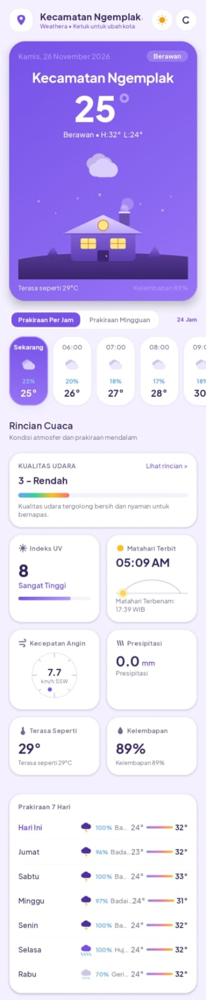
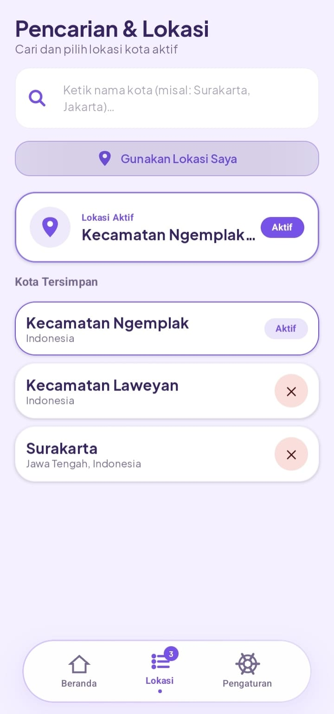
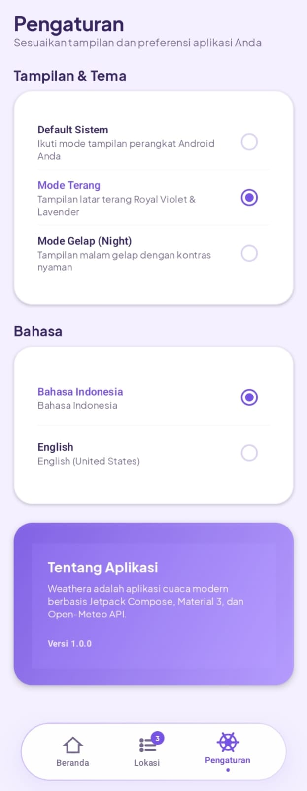
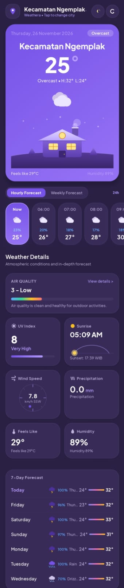
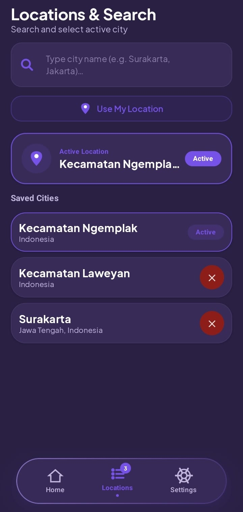
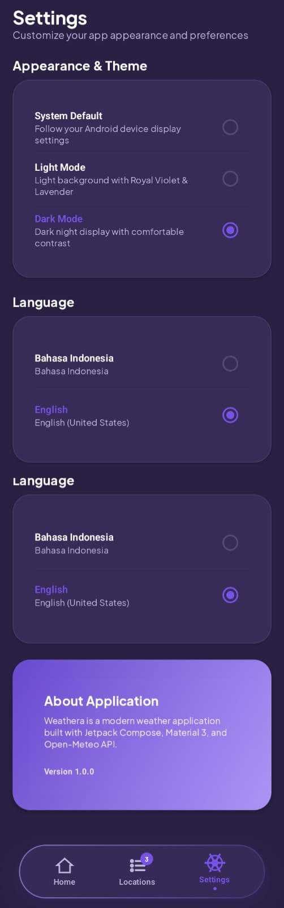

# 🌤️ Weathera — Weather Forecast App

**Weathera** adalah aplikasi cuaca berbasis Android yang dirancang untuk memberikan informasi kondisi cuaca secara praktis, informatif, dan mudah dipahami. Aplikasi ini menyediakan informasi cuaca terkini, perkiraan cuaca harian, pengelolaan lokasi, serta berbagai indikator cuaca dalam satu antarmuka yang modern dan responsif.

## 📱 Application Preview

Weathera menyediakan tampilan antarmuka dalam dua pilihan tema, yaitu Light Mode dan Dark Mode.

### ☀️ Light Mode

| Home | Locations | Settings |
|:---:|:---:|:---:|
|  |  |  |
| **Home** | **Locations** | **Settings** |

### 🌙 Dark Mode

| Home | Locations | Settings |
|:---:|:---:|:---:|
|  |  |  |
| **Home** | **Locations** | **Settings** |

## ✨ Features

- **Current Weather** — Menampilkan informasi kondisi cuaca terkini berdasarkan lokasi aktif.
- **Weather Forecast** — Menyediakan perkiraan cuaca hingga 7 hari ke depan.
- **Weather Metrics** — Menampilkan informasi kualitas udara, indeks UV, kecepatan angin, curah hujan, suhu yang dirasakan, dan kelembapan.
- **Weather Details** — Menyediakan informasi lebih lanjut mengenai indikator cuaca.
- **Location Management** — Mencari, menambahkan, memilih, dan mengelola lokasi.
- **Sunrise & Sunset** — Menampilkan informasi waktu matahari terbit dan terbenam.
- **Dark Mode** — Mendukung Light Mode, Dark Mode, dan System Default.
- **Multilingual** — Mendukung Bahasa Indonesia dan English.
- **Responsive UI** — Menyesuaikan tampilan dengan orientasi layar portrait maupun landscape.

## 🛠️ Technologies

| Technology | Description |
|---|---|
| Kotlin | Main programming language |
| Jetpack Compose | Modern declarative UI toolkit |
| MVVM | Application architecture |
| Repository Pattern | Data management structure |
| Retrofit | HTTP client for API integration |
| Open-Meteo API | Weather forecast data |
| Open-Meteo Geocoding API | Location search and geocoding |
| Android Studio | Development environment |

## 🌐 API Sources

Weathera menggunakan layanan Open-Meteo untuk memperoleh informasi cuaca dan lokasi.

- **Weather API:** https://open-meteo.com/
- **Geocoding API:** https://open-meteo.com/en/docs/geocoding-api

Penggunaan layanan API mengikuti ketentuan dan lisensi yang berlaku dari Open-Meteo.

## 🧭 Application Navigation

Weathera memiliki tiga bagian navigasi utama:

1. **Home** — Menampilkan kondisi cuaca terkini, ringkasan prediksi, indikator cuaca, serta perkiraan cuaca mingguan.
2. **Locations** — Memungkinkan pengguna mencari dan mengelola lokasi untuk melihat informasi cuaca.
3. **Settings** — Menyediakan pengaturan tema, bahasa, dan informasi aplikasi.

## 🏗️ Architecture

Aplikasi menggunakan pendekatan **MVVM (Model-View-ViewModel)** yang dikombinasikan dengan Repository Pattern.

Pemisahan tanggung jawab ini membantu menjaga kode agar lebih terstruktur, mudah dipelihara, dan dikembangkan.

```text
UI (Jetpack Compose)
        |
        v
    ViewModel
        |
        v
   Repository
        |
        v
 Retrofit / API Service
        |
        v
   Open-Meteo API
        |
        v
     Weather Data
```

## 🚀 Getting Started

### Prerequisites

Pastikan perangkat pengembangan telah memiliki:

- Android Studio.
- Android SDK.
- Kotlin support.
- Koneksi internet.

### Installation

1. Clone repository:

```bash
git clone (https://github.com/salliemarsha/Weathera.git)
```

2. Buka proyek menggunakan Android Studio.
3. Tunggu proses Gradle Sync hingga selesai.
4. Hubungkan perangkat Android atau jalankan emulator.
5. Klik **Run** untuk menjalankan aplikasi.

## 📂 Project Structure

Struktur proyek mengikuti pemisahan tanggung jawab berdasarkan arsitektur MVVM dan Repository Pattern.

```text
app/
└── src/
    └── main/
        ├── java/
        │   └── [package-name]/
        │       ├── data/
        │       ├── model/
        │       ├── repository/
        │       ├── ui/
        │       ├── viewmodel/
        │       └── ...
        ├── res/
        │   ├── drawable/
        │   ├── values/
        │   └── values-in/
        └── AndroidManifest.xml

screenshots/
├── home-light.png
├── locations-light.png
├── settings-light.png
├── home-dark.png
├── locations-dark.png
└── settings-dark.png
```

## 🔒 Permissions

Aplikasi memerlukan akses internet untuk mengambil data cuaca dan informasi lokasi dari layanan API.

```xml
<uses-permission android:name="android.permission.INTERNET" />
```

## 🎨 Design

Weathera mengutamakan tampilan yang modern, sederhana, dan informatif dengan memperhatikan:

- Konsistensi komponen antarmuka.
- Keterbacaan informasi cuaca.
- Dukungan tema terang dan gelap.
- Kemudahan navigasi.
- Responsivitas pada berbagai orientasi layar.

## 📄 License

This project is developed for educational and portfolio purposes.

Weather data is provided by [Open-Meteo](https://open-meteo.com/), subject to its applicable terms and attribution requirements.

---

**Weathera — Weather Information at Your Fingertips.**
